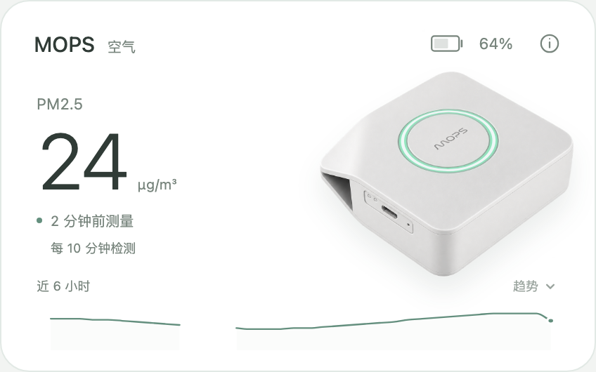

# MOPS BLE：Home Assistant 忻风 PM2.5 集成

[English](README.md) · 简体中文

将 **MOPS 忻风 AD520-P001 PM2.5 检测仪**通过本地蓝牙接入 Home Assistant，
读取空气质量与设备状态，并设置分时检测。

集成复用 Home Assistant 原生蓝牙管理，支持 ESPHome 主动蓝牙代理。
无需原厂 App、账号、云服务、MQTT 或修改检测仪固件。

**项目状态**：公开测试版（`1.0.1b2`），由
[hallucigenia](https://github.com/hallucigenia) 维护的非官方社区项目。

## 功能

每台检测仪提供六个实体：

| 实体 | 类型 | 用途 |
| --- | --- | --- |
| PM2.5 | 传感器 | 浓度，单位 µg/m³，支持 Home Assistant 统计 |
| 电量 | 传感器 | 电池百分比，诊断实体 |
| 充电中 | 二元传感器 | 设备上报的充电状态，诊断实体 |
| 最近测量时间 | 传感器 | 实际采样时间，诊断实体 |
| 分时检测 | 开关 | 启用或停用定时采样 |
| 检测间隔 | 选择器 | 可选 10、15、30、60、90、120 分钟 |

分时检测开关控制采样计划，不控制整机电源。固件 1.12 会拒绝 5 分钟间隔，
因此集成不提供该选项。

## 兼容范围

以下组合已通过实机验证：

| 项目 | 已验证型号或版本 |
| --- | --- |
| 检测仪 | MOPS AD520-P001 |
| 检测仪固件 | 1.12 |
| Home Assistant Core | 2026.11.1 |
| 蓝牙连接方式 | ESPHome 主动蓝牙代理 |

声明的最低 Home Assistant 版本为 **2026.11.1**，与已验证版本一致。
其他 HA 版本、检测仪固件、相近 AD520 型号及直连蓝牙适配器尚未验证。
如果测试了其他组合，欢迎提交
[兼容性报告](https://github.com/hallucigenia/ha-mops-ble/issues/new/choose)。

## 安装

选择以下任一方式安装，再继续完成[配置](#配置)。

### 通过 HACS 自定义存储库安装

1. 打开 **HACS → ⋮ → 自定义存储库**。
2. 添加 `https://github.com/hallucigenia/ha-mops-ble`，类别选择「集成」。
3. 在 HACS 中找到 **MOPS PM2.5 Monitor** 并下载。
4. 重启 Home Assistant。

本项目通过自定义存储库分发，未进入 HACS 默认目录。

### 手动安装

1. 在 GitHub 仓库页面选择 **Code → Download ZIP**，下载并解压源码。
2. 将 `custom_components/mops_ble` 整个文件夹复制到 Home Assistant 配置目录的
   `custom_components` 下，保留所有文件，包括许可证与声明。
3. 重启 Home Assistant。

最终应存在 `<config>/custom_components/mops_ble/manifest.json`，
其中 `<config>` 代表 Home Assistant 配置目录。

## 配置

### 1. 准备蓝牙连接

- 启用 Home Assistant 的 [Bluetooth 集成](https://www.home-assistant.io/integrations/bluetooth/)。
- 如果使用 [ESPHome 蓝牙代理](https://esphome.io/components/bluetooth_proxy/)，
  先通过 ESPHome 集成将代理接入 HA，并在**代理的 ESPHome 配置**中启用主动连接：

  ```yaml
  bluetooth_proxy:
    active: true
  ```

- 至少预留一个蓝牙连接名额。集成运行时，每台检测仪持续占用一个主动连接。
- 将检测仪开机并放在适配器或代理附近，关闭正在连接它的手机 App。

仅转发广播的被动代理无法提供本集成所需的蓝牙连接。

### 2. 添加检测仪

1. 打开「**设置 → 设备与服务**」。
2. 配置自动发现的 MOPS 检测仪。如果未显示，选择「添加集成」，搜索
   **MOPS PM2.5 Monitor / MOPS 忻风 PM2.5 检测仪**，再选择可见设备。
3. 进入设备页面，按需分配区域或修改实体名称。

MOPS 集成本身无需 YAML 配置。手动输入蓝牙地址时，设备仍须已被 HA 发现且广播匹配。
实体 ID 由 Home Assistant 自动生成，无需使用固定名称。

连接时，集成会同步检测仪时钟，并保留设备当前的采样模式和检测间隔。
蓝牙适配器及代理的配置与凭据继续由 Home Assistant 管理。

## 测量与控制行为

### 测量数据

检测仪可能重复推送同一条测量。集成按实际采样时间识别新数据；
重复状态包、旧历史和命令确认不会生成新读数。

过期数据会显示为「**不可用**」，不会填为零：

- **连接**：蓝牙断开时实体变为不可用，集成通过 HA 尝试重连。
- **遥测**：超过 90 秒未收到遥测后数据失效；电量、充电状态和设置还要求各自的上报不超过 90 秒。
- **采样**：PM2.5 与最近测量时间在分时检测间隔加 90 秒后失效，最低有效期为 180 秒；
  关闭分时检测时，有效期为 180 秒。

集成每 30 秒检查一次可用性，因此界面可能比阈值延后最多一个检查周期。
已记录的历史数据会保留。

### 修改设置

只有检测仪发来新的、完整的设置上报，且包含目标值，集成才确认修改成功。
蓝牙写入成功或收到命令确认本身不足以确认设置已生效。

确认超时时，Home Assistant 会提示错误。集成不会自动重发控制命令；
再次操作前，请先检查检测仪当前的设置。

## 常见问题

| 问题 | 排查方法 |
| --- | --- |
| 添加集成时搜不到 MOPS | 确认 HA 配置目录下存在 `custom_components/mops_ble/manifest.json`，然后重启 HA |
| 发现不了检测仪 | 检查电源、距离、Bluetooth 集成，以及是否被其他 App 占用连接 |
| 已发现但无法连接 | 检查代理是否启用主动连接、是否有空闲名额，并将检测仪移近 |
| 实体显示不可用 | 检查检测仪电源和蓝牙覆盖，等待 HA 自动重连 |
| PM2.5 或最近测量时间不更新 | 检查设备采样模式与间隔；频繁的状态包不代表产生了新采样 |
| 修改设置失败 | 重试前先确认设备当前设置；固件 1.12 不接受 5 分钟间隔 |

卸载时，先在「**设置 → 设备与服务**」删除集成条目，再通过 HACS 移除组件，
或删除手动安装的 `custom_components/mops_ble` 目录，然后重启 Home Assistant。

## 可选空气卡片

[MOPS Air](frontend/README.zh-Hans.md) 提供写实机身、呼吸灯环、6／24 小时真实采样历史、
电量与充电状态及原生设置，支持自定义实体和中英文界面。集成安装后按文档手动安装卡片；
HACS 的 Integration 安装不会注册卡片资源。



安装步骤见[卡片说明](frontend/README.zh-Hans.md)，另有[呼吸与充电动图](frontend/docs/card-motion.gif)。
预览数据全部为合成示例，灯环表达浓度视觉分段，不代表硬件灯效或 AQI 等级。

## 反馈与开发

问题与兼容性反馈请提交到
[Issues](https://github.com/hallucigenia/ha-mops-ble/issues/new/choose)，
代码修改可提交 [Pull Request](https://github.com/hallucigenia/ha-mops-ble/pulls)。
请提供检测仪型号与固件、HA 与集成版本、蓝牙连接方式、复现步骤，以及预期和实际行为。

分享附件前请先检查内容。不要公开完整 HA 备份、设备地址、访问令牌、代理密钥、
内网域名或可识别家庭信息的截图。详见[隐私说明](PRIVACY.md)和
[贡献指南](CONTRIBUTING.md)。

在仓库根目录运行以下离线检查，使用与已验证 HA 运行环境一致的 Python 3.14：

```sh
python3 -B -m unittest discover -s tests -v
python3 scripts/check_package.py
python3 scripts/privacy_check.py --history
```

这些检查仅依赖 Python 标准库，不连接 HA。协议测试使用合成报文，
传输测试使用 HA／蓝牙桩对象，不能代替 HA 实际生命周期与硬件验证。
GitHub Actions 还会执行 hassfest 和 HACS 校验。版本变更见[更新日志](CHANGELOG.md)。

修改前端时还需执行 `npm run check:build`、`npm test` 和[合成浏览器验证](frontend/README.zh-Hans.md#开发与验证)。
开发环境使用 Node.js 22+ 与固定版本的 Playwright；浏览器验证不连接 HA，卡片运行时没有包依赖。

## 许可证与致谢

本项目**公开源码，供非商业使用**，采用 [PolyForm Noncommercial 1.0.0](LICENSE)。
非商业使用、修改及分享须保留要求的作者署名和许可声明。该许可不授予商业使用权，
不属于 OSI 认可的开源许可。

第三方参考材料保留各自许可，详见[第三方声明](THIRD_PARTY_NOTICES.md)。
本项目与 MOPS、Home Assistant 厂商或项目没有隶属或背书关系。
