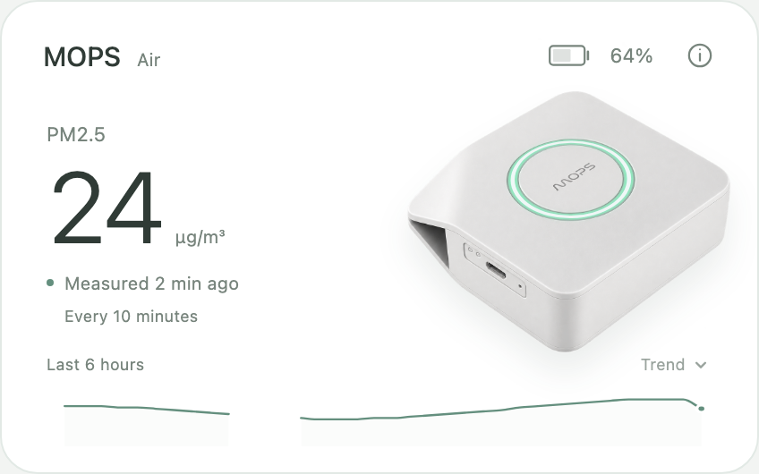

# MOPS Air dashboard card

English · [简体中文](README.zh-Hans.md)

An optional companion to [MOPS BLE](../README.md): PM2.5, actual sample times,
6/24-hour history, battery/charging status, and native measurement settings.
English and Simplified Chinese follow Home Assistant or a card-level override.



All screenshots and the [breathing and charging animation](docs/card-motion.gif)
use invented data. The [dark theme](docs/card-dark.png),
[expanded history](docs/card-history.png), [device settings](docs/card-settings.png),
and [two monitors](docs/two-monitors.png) are also shown separately.

## Install the card

The integration works independently of this card. HACS installs this repository
as an **Integration**; it does not install or register the optional frontend.
The card is installed manually, using HA's standard
[resource registration](https://contributors.home-assistant.io/frontend/custom-ui/resources/).
No build or Node.js installation is needed to use it.

1. Install and configure the MOPS BLE integration first.
2. Download [mops-air-card.js](https://github.com/hallucigenia/ha-mops-ble/releases/download/v1.0.1b2/mops-air-card.js).
   The same built file is in [dist/mops-air-card.js](dist/mops-air-card.js).
3. Copy it to `www/mops-air-card.js` in your HA configuration directory.
   If you just created the `www` directory, restart HA once so it can serve it.
4. Open **Settings → Dashboards → ⋮ → Resources → Add resource**. Enter
   `/local/mops-air-card.js?v=1.0.1b2` and choose **JavaScript module**.
   Enable Advanced mode in your user profile if the Resources entry is hidden.
5. Reload the browser, then edit a dashboard, choose **Add card → Manual**,
   and paste the example below with your own entity IDs.

```yaml
type: custom:mops-air-card
name: MOPS
entity: sensor.mops_pm25
measured_entity: sensor.mops_last_measurement
battery_entity: sensor.mops_battery
charging_entity: binary_sensor.mops_charging
periodic_entity: switch.mops_periodic_measurement
interval_entity: select.mops_measurement_interval
```

These IDs are examples. Find the actual entities on your monitor's device page:
HA generates their IDs, and they may include a device suffix. Select all six
entities from the **same monitor**. The card does not need a device registry ID,
Bluetooth address, area, additional credentials, or a particular dashboard layout.
The first version uses YAML configuration, without a visual configuration editor.

| Option | Required | Meaning |
| --- | --- | --- |
| `entity` | Yes | Native MOPS PM2.5 sensor, in μg/m³ |
| `measured_entity` | Yes | Actual sample timestamp sensor |
| `battery_entity` | Yes | Battery percentage sensor |
| `charging_entity` | Yes | Charging binary sensor |
| `periodic_entity` | Yes | Periodic measurement switch |
| `interval_entity` | Yes | Measurement interval select |
| `name` | No | Card and dialog title; default `MOPS` |
| `location` | No | Optional text shown in device information; hidden when omitted |
| `language` | No | `auto` (default), `en`, or `zh-Hans` |

For a second monitor, add another card and replace all six entity IDs. Each card
has its own history and animation state. Changing entity bindings clears old
observations and ignores history responses from the previous monitor.

## Reading and controlling the monitor

Select the value, device illustration, or sparkline to expand 6/24-hour history.
Use a mouse, touch, or arrow keys on the chart to inspect a sample. Select the
battery or information button for settings and device information.

- Zero is a valid PM2.5 or battery reading. Unknown values remain unknown.
- Freshness uses the **actual sample timestamp**, not repeated Bluetooth reports.
  Periodic mode allows the selected interval plus 90 seconds, with a minimum of
  180 seconds; continuous mode allows 180 seconds. The card checks every 30 seconds.
- Stale, restored, disconnected, future-dated, or wrong-unit readings show a dash
  and extinguish the ring. Already loaded history is retained on disconnect.
- Recorded concentration and timestamp series are paired at actual sample times.
  Repeated samples are deduplicated; explicit gaps remain visible. If timestamp
  history is absent, recorded PM2.5 update times are used instead. A lone current
  sample remains a single point. History failures expose a retry button.
- History needs HA's History/Recorder support and retained MOPS data. The card
  reads up to 24 hours on opening and every five minutes while visible. It does
  not configure Recorder or retrieve old samples directly from the monitor.
- Settings use HA's native switch/select services. A successful service call and
  a fresh matching entity state are both required within 30 seconds. Errors or
  missing confirmation retain actual state and do not automatically resend.

The ring uses a visual concentration mapping: below 35, 35–74, and 75 or above,
with 8/6/4-second breathing. A ±3 μg/m³ buffer reduces changes near boundaries.
These bands **are not AQI categories**. The animation **does not report the
hardware LED state**. Charging uses a six-second sheen through the true battery
fill, without increasing the displayed percentage. Low battery stays static.
Animations honor reduced motion and pause when hidden or offscreen.

## Update, remove, and troubleshoot

Replace the JS file when updating, change its resource URL version, then reload
the browser. Keep one resource entry for the card. A missing custom element
usually means the resource is absent, cached, or registered with the wrong type.
A dash means the entity binding, availability, unit, or actual sample freshness
needs checking. Missing history needs checking in HA's History/Recorder settings.

To remove the card, delete its dashboard cards, remove its resource entry, and
delete `www/mops-air-card.js`. The BLE integration and its entities keep working.

The bundle contains its artwork and has no external runtime imports, analytics,
manufacturer endpoint, or embedded authentication. It uses the `hass` object
provided by HA for history and native actions. All public preview controls are
isolated from HA, and the preview's CSP disallows network connections.

## Build and test

Node.js 22+ builds the standalone JS without a bundler dependency:

```sh
npm run build
npm run check:build
npm test
```

For browser checks and the synthetic interactive preview:

```sh
npm ci --ignore-scripts
npx playwright install chromium
npm run test:browser
npm run preview
```

Open `http://127.0.0.1:8438/`. `MOPS_PREVIEW_PORT` changes the local port. The
server only serves explicit demo files and the bundle. It does not load a HA
session or expose repository files. Browser tests use a synthetic HA adapter;
they do not establish fresh-install or real-device compatibility by themselves.
The integration's real-hardware compatibility is listed in the root README.

Source is in `src/`, artwork in `assets/`, synthetic fixtures in `demo/`, and
tests in `test/`. Commit both the source changes and deterministic `dist/` output.
The original artwork is hash-checked so a replacement cannot silently move the
ring away from its fitted boundary. Follow the root privacy checks before sharing.

## Artwork and license

The [source record](assets/sources.json) documents the generated device depiction,
reference image, content review, and preserved C2PA provenance. It is an
unofficial illustration, not an official manufacturer photo. The original PNG is
embedded unchanged. The UI ring is drawn separately.

Code and project artwork follow [PolyForm Noncommercial 1.0.0](../LICENSE) and the
[required notice](../NOTICE). See [third-party notices](../THIRD_PARTY_NOTICES.md)
for references and manufacturer marks. Preserve the JS header and these notices
when sharing the card or a modified copy.
