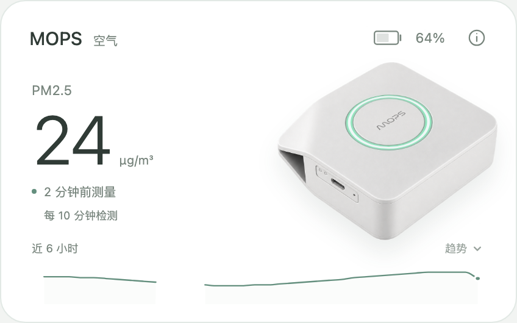

# MOPS Air 空气卡片

[English](README.md) · 简体中文

[MOPS BLE 集成](../README.zh-Hans.md)的可选配套卡片，显示 PM2.5、实际采样时间、
6／24 小时历史、电量与充电状态，并提供原生分时检测设置。支持跟随 HA 的中英文界面。



截图与[呼吸及充电动图](docs/card-motion.gif)全部使用合成数据，另可查看
[深色主题](docs/card-dark.png)、[展开历史](docs/card-history.png)、
[设备设置](docs/card-settings.png)及[两台检测仪](docs/two-monitors.png)。

## 安装

集成可以独立使用。HACS 将本仓库作为 **Integration** 安装，不会安装或注册可选卡片。
卡片按 HA 标准[资源注册方式](https://contributors.home-assistant.io/frontend/custom-ui/resources/)
手动安装，使用时不需要 Node.js 或本地构建。

1. 先安装并配置 MOPS BLE 集成。
2. 下载 [mops-air-card.js](https://github.com/hallucigenia/ha-mops-ble/releases/download/v1.0.1b2/mops-air-card.js)，
   或使用仓库中的同一份[构建产物](dist/mops-air-card.js)。
3. 将文件放入 HA 配置目录的 `www/mops-air-card.js`。如果刚创建 `www` 文件夹，
   需要先重启一次 HA，之后才能通过 `/local/` 提供文件。
4. 打开 **设置 → 仪表盘 → 右上角 ⋮ → 资源 → 添加资源**，填写
   `/local/mops-air-card.js?v=1.0.1b2`，类型选 **JavaScript 模块**。
   看不到资源入口时，检查个人资料中的高级模式。
5. 刷新浏览器，编辑仪表盘，选择 **添加卡片 → 手动**，粘贴下面的 YAML，并替换实体 ID。

```yaml
type: custom:mops-air-card
name: MOPS
entity: sensor.mops_pm25
measured_entity: sensor.mops_last_measurement
battery_entity: sensor.mops_battery
charging_entity: binary_sensor.mops_charging
periodic_entity: switch.mops_periodic_measurement
interval_entity: select.mops_measurement_interval
```

上面的 ID 只是示例，实际 ID 由 HA 生成，可能带设备后缀。请在检测仪的设备页面中查找，
六个实体都选择**同一台检测仪**的实体。卡片不需要设备注册 ID、蓝牙地址、房间归属、
额外认证或指定仪表盘布局。首版通过 YAML 配置，没有可视化配置编辑器。

| 配置项 | 必填 | 作用 |
| --- | --- | --- |
| `entity` | 是 | MOPS 原生 PM2.5 传感器，单位 μg/m³ |
| `measured_entity` | 是 | 实际采样时间传感器 |
| `battery_entity` | 是 | 电量百分比传感器 |
| `charging_entity` | 是 | 充电状态二元传感器 |
| `periodic_entity` | 是 | 分时检测开关 |
| `interval_entity` | 是 | 检测间隔选择实体 |
| `name` | 否 | 卡片与设备弹窗标题，默认 `MOPS` |
| `location` | 否 | 设备信息中的位置文字，未填写时隐藏 |
| `language` | 否 | `auto`（默认）、`en` 或 `zh-Hans` |

第二台检测仪使用另一张卡片，替换全部六个实体 ID。每张卡片的历史和动画各自独立。
切换实体绑定时清空上一台设备的观察缓存，并忽略旧的历史请求回包。

## 使用与数据含义

点击读数、机身或小曲线展开 6／24 小时历史，支持鼠标、触摸与键盘方向键查看测点。
点击电量或信息按钮打开设备设置。

- PM2.5 和电量的合法零值均保留，未知状态显示未知。
- 新鲜度以实际采样时间判断，重复蓝牙上报不延长有效期。分时模式为检测间隔加
  90 秒，最低 180 秒；连续模式为 180 秒，每 30 秒检查一次。
- 过期、恢复、断连、未来时间或单位不符时隐藏当前值并熄灭灯环。断连保留已读取历史。
- 将浓度与采样时间的原始历史配对，去重重复测量并保留明确断口。没有采样时间历史时，
  才使用 PM2.5 的原始上报时间；单个当前测点保持为单点。历史失败时提供重试按钮。
- 历史依赖 HA 的 History／Recorder 及已保留的实体数据。可见时读取最多 24 小时历史，
  每五分钟刷新；卡片不会修改 Recorder 或直接向检测仪读取旧采样。
- 设置使用原生 switch／select 服务，必须同时收到服务成功和实体的新状态确认，
  最多等待 30 秒。失败或未确认时保留实际状态，不自动重发。

灯环使用浓度视觉分段：低于 35、35–74、75 及以上分别为 8／6／4 秒呼吸，
边界有 ±3 μg/m³ 缓冲。这些分段**不是 AQI 等级**，也**不代表读取到了硬件灯效**。
充电时每六秒一次柔和高光，仅经过实际电量填充范围，不模拟电量增长；低电量静态提醒。
动画遵循减少动态效果设置，离屏或隐藏时暂停。

## 更新、卸载与排查

更新时替换 JS 文件，修改资源 URL 的版本参数并刷新浏览器，保留一个资源入口即可。
提示自定义组件不存在时检查资源地址、类型和缓存。当前读数为“—”时检查实体绑定、
可用状态、单位与实际采样时间；缺少历史时检查 HA 的 History／Recorder。

卸载时删除对应卡片、资源入口与 `www/mops-air-card.js`；BLE 集成和实体继续工作。
构建产物包含机身素材，没有外部运行时依赖、统计追踪或内嵌认证，历史与动作使用 HA
提供的 `hass` 对象。公开预览只操作本页合成数据，CSP 禁止发起网络连接。

## 开发与验证

Node.js 22+ 可独立构建，无需安装打包器：

```sh
npm run build
npm run check:build
npm test
```

浏览器验证与合成交互预览：

```sh
npm ci --ignore-scripts
npx playwright install chromium
npm run test:browser
npm run preview
```

预览地址为 `http://127.0.0.1:8438/`，可用 `MOPS_PREVIEW_PORT` 调整端口。
服务器只开放明确列出的预览资源，不读取 HA 会话或开放仓库文件。
浏览器测试使用合成 HA 适配器，不能单独证明全新 HA 安装或实机兼容性；
集成已经验证的硬件组合见仓库根目录说明。

源码、素材、示例和测试分别位于 `src/`、`assets/`、`demo/`、`test/`。
修改后同时提交源码与确定性构建的 `dist/` 产物。构建核对机身原图摘要，
避免换图后灯环与真实边界偏离。分享前执行根目录隐私检查。

[素材说明](assets/sources.json)记录生成方式、产品参考来源、内容审查和保留的 C2PA
来源信息。机身是非官方生成插画，原始 PNG 字节不变；灯环由界面单独叠加。
代码和项目素材沿用 [PolyForm Noncommercial 1.0.0](../LICENSE) 与
[作者声明](../NOTICE)，参考资料及商标说明见[第三方声明](../THIRD_PARTY_NOTICES.md)。
分享卡片或修改版时保留 JS 文件头及这些声明。
